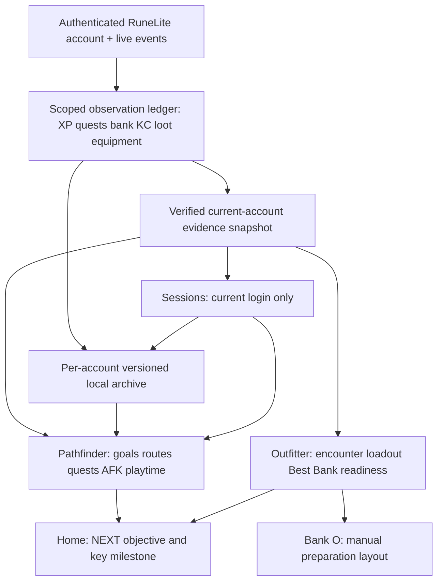

# FERAL ENTERPRISES | TRASHPANDA TRACKER | SINGLE SOURCE OF TRUTH
**Revision:** 2026-11-01 R01 | **Mode:** project decisions and implementation map | **Release:** HOLD

## Decision hierarchy (do not silently revert)
1. **The user's newest direct decisions govern.** Iron Ledger is a historical product/reference, **Project Burrow / TrashPanda Tracker is the active clean-rebuild product**. The name remains provisional; no unapproved repo rename.
2. Four main tabs **Home / Pathfinder / Outfitter / Sessions**. Settings accessible through header, bank O/crest separate in the native bank. Original Feral Modern style: 225px graphite, restrained bronze/gold and small raccoon icon. No standalone Outfitter application, no giant player-stat table, no oversized raccoon.
3. **Ironman is default** for newly observed accounts, Main optional in Settings, preferences per authenticated account. No compulsory first-run wizard.
4. **Outfitter scope:** regular repeatable standalone bosses, Barrows, God Wars, Dagannoth Kings, three Perilous Moons, plus an extensible **Demi-bosses** group (Tormented Demons, Demonic Gorillas, Lizardman Shamans). Explicitly exclude all raids (CoX, ToB, ToA, Fractured Archive), Gauntlet Hunllefs, Jad/Fight Caves, Zuk/Inferno, Colosseum, Tempoross/Wintertodt/Zalcano, Revenant maledictus and one-off quest bosses. Do not misrepresent discovery-only bosses as verified strategies. Existing approved exception list takes precedence over old roadmaps.
5. **Wilderness:** all 11 flagged encounters, including KBD's Wilderness approach, need visible PK warnings. **Best in Bank MUST be inaccessible** via toggle, planner, cache, background preload and UI. No fallthrough. Wilderness rare-drop information may be shown with warnings.
6. **Combat-style selectors:** Melee red, Ranged green, Magic blue, intuitive icon buttons; hybrids show multiple active styles. The method dropdown remains for detailed strategies.
7. Wiki Recommended and Best in Bank are **distinct modes**; Entry/Recommended/Optimal are **tiers**. Canonical reviewed Wiki templates are immutable. Bank scanning is automatic on bank open; bank item highlighting OFF by default, no automated bank actions.
8. **Sessions live view only shows current login.** At confirmed logout, live view clears immediately; a *separate per-account recent-10 archive* retains immutable completed-session summaries. Teleports, loading, same-account hops do not end a session or disable XP intention. No fabricated XP/KC/drops.
9. **No results by implication.** A selected quest is not completed; a boss loot drop is not a KC; a collection-log unique is not current bank ownership; bank contents unavailable is not empty; an owned item is not necessarily equippable; a successful synthetic test is not Windows acceptance.
10. **Results first, release HOLD.** One authoritative numbered source build, exact ZIP and SHA-256, changed-files + proof + blocker summary. A WIP save is a checkpoint, not a numbered accepted build. Never overwrite/reuse build numbers. No speculative source reset, no ticket paperwork replacing artifacts.

## Current evidence and sources

| Version | Actual state | Evidence grade |
|---|---|---|
| **Build 19** | Fully delivered source, actual RuneLite Windows launch; physical wheel works; 4 tabs, quests (179/214, 5 in progress, 0 scan errors), Pathfinder category filtering, real bank/gear/inventory, XP gained and two TD boss drops; actual logout resets live data | OWNER WINDOWS: scope-limited PASS. XP tracking re-arms after loading, boss KC/supplies unavailable; bank recommendation quality incomplete |
| **Build 20 checkpoint 1** | 61 encounter discovery entries; 11 Wilderness no-Best-Bank policy; 3 Demi-bosses; red/green/blue style tiles; XP default ON and LOADING pause/rebaseline logic; draft Shamans loadouts | SOURCE + CLAUDE-REPORTED 204/204 OFFLINE; **not** owner Windows accepted |
| **Build 20 Delta 2** | New Pathfinder activity dropdown, minutes dropdown, Active/Low/AFK selector, source-bounded AFK filtering | SOURCE + CLAUDE-REPORTED 209/209 OFFLINE; **not** owner Windows accepted |
| **Further active Claude B20 work** | Rare-drop registry, Collection Log observer, boss/method review may continue after Delta 2 | NOT in our last verified archive. Never assert finished without complete newer source ZIP |
| **Iron Ledger master history** | Offline journals, weekly reports, goals/undo, Boss Chronicle, custom presets, native bank grid, math gear optimizer concepts, final-departure checklist, exports | Historical requirements/reference; **not** proven as implemented in current Burrow |

**Authoritative snapshot on hand:** `20-WIP-CONSOLIDATED-THROUGH-DELTA-2-INTELLIJ.zip` SHA-256 `0470e7e0bd222e7b3d6f88d796d5bb70f6050cad2462701dc2a1a61291ebd1e7`. **Rollback:** `19-TRASHPANDA-B19-PATHFINDER-BESTBANK-WHEEL-INTELLIJ.zip` SHA-256 `1133a60eb4481b0290545c88653dbbdd1915a2334f9a4cc628efd9eb8f086b5d`. The active Claude workspace may be ahead of Delta 2; ask for its latest complete source rather than reverting it.

## Architecture: where each piece lives

**Data contract:** Every snapshot and cached plan records account scope, login epoch, bank generation, acquisition/provenance, and freshness. Unknown remains unknown. Any background result must be discarded if account or bank generation changes. Preloader count alone is not sufficient freshness proof. Persist only player-safe local records; do not bundle account data, auth state or credentials in source ZIPs.

### 1. HOME | Armory Workbench
**Purpose:** A clear answer to **what should I do next?**
- **Retain:** selected encounter, combat method, current weapon, quick Outfitter/Sessions buttons, compact 225px dashboard.
- **Add:** NEXT chosen Pathfinder goal with one small immediately feasible step; LAST verified completed milestone; three compact suggestions (skilling, combat, quest/diary); meaningful weekly highlight from trustworthy journal entries.
- **Avoid:** RuneLite's complete skills/XP table, simulated progress, giant card stacks, latest-event-as-most-important bias.
- **Acceptance:** choose a goal in Pathfinder, return Home, see same goal and correct next prerequisite; logout does not invent success; milestone only if actually observed.

### 2. PATHFINDER | Route Intelligence
**Purpose:** Turn account observations and player-selected goals into **specific achievable next actions**.
- **Working baseline:** 393 structured rules across quest-order, 91 AFK, 35 money, boss, gear and legacy, plus live RuneLite quest survey and per-account settings. 215 quest-order entries, 213 mapped RuneLite quests; *not* the full ~576-step interactive walkthrough.
- **Build 20 WIP:** category dropdown (All, Quests, PvM, Money, Supplies, AFK); duration dropdown (15,30,45,60,90,120); clear Active/Low/AFK selector. Must be verified in Windows.
- **To build:** persistent saved goals, priority/skip/done/undo; dependency graph beyond major quest chains, diaries (never claim an unobserved diary is complete), meaningful skill/bank requirements, source-attributed gear paths, practical alternatives, an explicitly labeled complete/incomplete guide coverage report.
- **Plan My Session:** invoked from Sessions or Pathfinder; uses player-chosen time, attention, goal, prep/travel overhead and observed prereqs. The player chooses a plan; the app **does not mark it completed**. On session progress/finish, actual observed activity feeds replanning and Home NEXT.
- **No silent magic:** Some guide steps cannot be observed (quest points, kudos, achievement tasks, diaries); present manual verification/check state. Do not treat general equipment wishes as mandatory boss access prereqs.
- **Acceptance:** genuinely observed account changes suggestions; completed quest disappears; a boss is not falsely READY because its quest or bank observation is unknown; goal persists after restart; AFK suggestions include sourced intervals and remaining time.

### 3. OUTFITTER | Field Terminal
**Purpose:** Prepare a genuinely usable encounter setup and learn boss-specific results.
- **Scope and separation:** category Regular / Wilderness / Moons / Demi-bosses; 61 entries in Build 20 WIP; some are discovery-only. Store explicit `verified/research_only/unsupported` per boss, method, tier. No encounter excluded by owner appears in dropdown.
- **Source modes:** Wiki Recommended = immutable reviewed strategy; Best in Bank = verified owned/equippable coherent entire trip; no Best in Bank for Wilderness, unknown/default-deny.
- **Tier × method audit:** each eligible boss requires per-method Entry/Recommended/Optimal decisions **only where sourced**. 11 equipment slots and 28 ordered inventory cells including variants, spellbook, runes, ammo, charges, food, potions, swap equipment, travel and necessary empties. If incomplete, say `Guide not yet verified` and do not invent a loadout.
- **Better-than-curated Best in Bank (future depth):** evaluate whole compatible owned combinations, accuracy/DPS/max-hit where supported, gear set effects, defense/survivability, boss vulnerabilities and task requirements; no automatic DFS vs dragon defender choice. Explain alternatives and why chosen; never claim an unsupported DPS percentage.
- **Manual switch layout QoL:** mark preferred inventory positions for Scorching Bow, Emberlight and defender without moving items. Track 1H/2H/offhand and real free slots.
- **Boss Loot Table (inside Outfitter, not generic Loot Tracker):** authenticated KC only if verified; actual boss-attributed drops + supplies consumed, optional estimated value and net with price source/date; per-boss records and coverage. Supplies transferred from bank ≠ consumed.
- **Rare-drop panel:** verified loot tables with source/dates and roll groups; selectable rare targets, ANY/ALL aggregation using correct dependencies, 50/75/90/95% milestones, conditional/guaranteed drops modeled separately. Current true KC, historical observed KC, or clearly labeled manual/hypothetical KC. No invented rates, no dry-streak guarantee. Collected unique unlock ≠ owned bank item.
- **Collection Log / historical KC:** read-only observer of a supported in-game log page, per-account with coverage and source; optional official HiScores; manually entered historical values remain *Manual*. Never claim all pages scanned without opening or authorized API. Keep current-login KC separate from history.
- **Acceptance:** all 61 scope entries categorized; explicit full profile coverage matrix; no Wilderness Best Bank path; source-backed alt sets and verified inventory; real rarity data never combined with incompatible roll assumptions; native tooltip and correct item sprites.

### 4. SESSIONS | Current-Login Ledger
**Purpose:** Record only what actually happened during this login, plus an optional separate small history drawer.
- **Live verified in Build 19:** genuine per-skill XP increases and boss-attributed TD drops appear; confirmed logout immediately clears the live view. KC gains and supplies consumed were still awaiting sources.
- **Critical Build 20 patch:** default XP ON without manual re-arm after teleport/map loading; pause/rebaseline safely to avoid invented XP during unknown interval, preserve totals, reset only on true logout/account change. WIP code exists; requires Windows gate.
- **Archive exactly last 10 completed sessions per account** (a separately labeled history view): on confirmed logout, atomically save summary: start/end, XP by skill, verifiable KC, drops, consumed supplies with unknown states, goal planned vs observed. Then immediately clear current-live dashboard. Never treat LOADING as logout.
- **Observed KC and supplies:** genuine boss KC from supported RuneLite sources with first reading baseline; distinguish per-session from lifetime. Consumption only if provable, not bank move/dose variant change double count. No synthetic kills.
- **Sessions ↔ Pathfinder loop:** button `Plan My Session`, selected goal and time; show optional observed progress, progress indicator, and `Replan`/`Continue` action. No gameplay automation or false completion.
- **Legacy Iron Ledger after stable core:** source-attributed boss chronicles, important quest/diary/collection milestones, weekly summaries and JSON/CSV data export.
- **Acceptance:** teleport twice, maintain XP total and auto resume; log out clears live instantly but history shows one completed summary; relog same account starts zero live; switch accounts shows distinct archive; no KC fabricated from a drop.

### 5. BANK O | Native preparation workspace
**Purpose:** Help player prepare efficiently from observed bank/inventory/equipment without doing actions for them.
- Preserve automatic scan on bank open and paced low-priority background preloader. Display age/freshness and separately bank, inventory, worn, combined; unknown must not be reported zero. Overlays never overwrite foreign tags/layouts.
- O/crest opens custom native bank tab: equipment left, supplies right with 28 positions, no compacting. Return to normal bank and clean up on close/logout/account switch. Player manually withdraws.
- Stock on hand distinct from required quantity and reserve. Gear/supplies highlighting optional OFF by default, no stale highlights. Correct charged/imbued variant IDs and doses. Use one resolved plan across Outfitter and bank layout.
- Acceptance: open bank → observe same account → prepare TD switching gear → close/reopen → no hidden bank state, no wrong ownership, no stuck tags or UI freezes.

### 6. SETTINGS and LOCAL HISTORY
- Ironman default, Main account override per account (preserved). Settings action in header, current version correct. Saved goals, session summaries, KC observations, manual overrides and custom loadouts are local per-account data, with migrations, safe offline export/import and no secrets included in project artifacts.
- Consider special Group/HCIM/UIM modes only after core Ironman/Main stability and separate user approval.

## Build-by-build execution plan

**GATE A | Finish the active Build 20 (the ONLY current code effort).**
- Continue from **Claude's latest actual source**, not blindly the Delta 2 fallback. Get a full source checkpoint before any change.
- Finish what Build 20 already owns: XP auto ON/teleport, Pathfinder dropdowns/AFK, boss registry/exclusions/Demi-bosses/Moons, Wilderness total BIB lockout, combat style icons, rare-drop registry/aggregation if current Claude is implementing, Collection Log observer where actual API is verified, and method-by-method Best Bank coverage report. Unsupported corners must be explicitly marked open; no invented 61 completed loadouts.
- Run full JDK17 Gradle clean test jar; keep full test results and protected original catalog hashes; clean-extract the artifact; create a genuine numbered `20-...-INTELLIJ.zip`, root launcher, QA read-first, side-by-side changes and known gaps. Windows gate tests XP across teleport, logout, UI controls, Wilderness, bank data, Scobo/Emberlight switching, scroll retention.
- **Stop at this gate** for owner native acceptance. Do not silently start Build 21 in the same Claude session.

**GATE B | Build 21: Reliable Account Memory + Sessions/Pathfinder Loop (next *major* task, only after A).**
- One versioned per-account persistence service for up to **10 completed sessions**, saved goal state and provenance; session live data stays isolated and resets on confirmed logout.
- Add `Plan My Session` button / Pathfinder journey link; actual 15–120-minute AFK/Active suggestions; observed XP/drop events feed a `review/replan` screen without implying goal completion.
- Prioritize authentic KC delta and supplies-used observer if a trusted source can be proven without destabilizing current XP/drop telemetry. Unknown remains unavailable. Do not claim historical KC through unsupported API.
- Test restart, logout, transient LOADING, same-account hop, A→B→A, stale event queue, per-account history, data migration and corruption recovery; JDK 17 genuine Gradle and owner-focused Windows steps.
- No changes to mouse wheel host or Outfitter canonical profiles unless required to fix a proven regression.

**GATE C | Build 22: Outfitter Quality Audit + Account-Aware Gear Optimizer.**
- Reconcile all **61 entries** with verified boss methods and complete profiles vs research-only, build a test case and source record per supported method/tier, fix variants/ammo/supply accuracy, add coherent combat-stat ranking and optional defense preference only when reliable.
- Integrate final-departure checklist, native bank O consistency, completed rare-drop provenance, boss loot table and current KC. Do not widen Wilderness safety policy.
- Run real scenarios for Vorkath, TD, Gorillas, Shamans, Scurrius, Mole, DKs, God Wars, Perilous Moons, Barrows, Wilderness warning; do not require all 61 to be verified if source unavailable, record gaps.

**GATE D | Build 23: Iron Ledger Legacy Wins + Coverage Completion.**
- Add meaningful Home NEXT/LAST and weekly highlight, saved goals complete/undo, deeper diary and recursive quest unlocks, Boss Chronicle history, safe export, custom gear presets, optional highlighting, final UI polish and accurate retained version labeling.
- Incorporate further verified Ironman route stages (including optional Sailing and remaining Mootrius research), not a claim to copy or embed third-party full text.

**GATE E | Release qualifications.**
- JDK17 Gradle on exact zipped source; static and dynamic account isolation; no fake KC or XP; playtest Windows and real game; error/edge-case handling; performance, safe migrations, reproducible artifact hash; explicit owner release decision. **Release HOLD until then.**

## Source-of-truth rules for Claude and future chats
- Use `02-FEATURE-REGISTER.csv` as the **one feature register**. Each line has `ID`, where it belongs, actual status, priority, target phase, implementation intent and one testable acceptance gate. Treat statuses as snapshots, update only with source/test evidence.
- Do not rename or reuse old BUR ticket IDs. Feature IDs in this register are **planning labels, not replacements for old tickets**. This prevents inventing statuses based on defunct R08 roadmaps.
- `03-SOURCE-AND-STATUS.json` has the exact authoritative ZIP filenames/hashes and status meanings. The active Claude workspace may be newer; update hashes only for a successfully received full-source ZIP.
- No self-contained task is CLOSED without its source/test result and honest Windows or source-only evidence grade. A human screenshot confirms only what it shows.
- Do not run parallel editing of `BurrowPlugin.java` or `BurrowPanel.java`; single writer per file, controlled diff vs accepted baseline; never replace the new source with older historical Iron Ledger material.
- The next Claude session must start by reading the latest build read-first and feature register and produce a recoverable ZIP **before** doing broad research or accumulating risky changes.